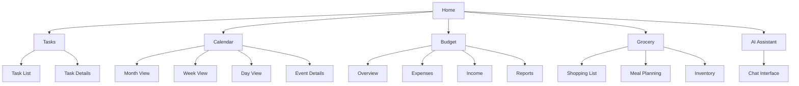

# Family Hub

A comprehensive family management platform designed to streamline household organization, communication, and planning.

## Table of Contents
- [Overview](#overview)
- [Tech Stack](#tech-stack)
- [Sitemap](#sitemap)
- [Features](#features)
- [Getting Started](#getting-started)
- [Development](#development)
- [Deployment](#deployment)

## Overview

Family Hub is a centralized platform for families to manage their schedules, tasks, budgets, and more. The application features a responsive design with a collapsible sidebar, comprehensive header navigation, and theme support.

## Tech Stack

### Frontend
- **Framework**: React 18.3.1
- **Language**: TypeScript 5.5.3
- **Build Tool**: Vite 5.4.8
- **Styling**: Tailwind CSS 3.4.13 with custom theme variables
- **UI Components**: shadcn/ui (Radix UI primitives)
- **Icons**: Lucide React
- **Form Handling**: React Hook Form with Zod validation
- **Date Handling**: date-fns
- **Charts**: Recharts

### Development Tools
- ESLint 9.11.1
- TypeScript ESLint 8.7.0
- PostCSS with Autoprefixer

## Sitemap



## Features

### Global Components

#### Header `/components/Header.tsx`
- **Main Navigation**: Primary app sections (Home, Tasks, Calendar, Budget, Grocery, AI Assistant)
- **User Profile**: Avatar with dropdown menu
- **Search Functionality**: Global search across all app sections
- **Weather Widget**: Current temperature and conditions
- **Time Display**: Current local time
- **Responsive Design**: Adapts for mobile, tablet, and desktop views
- **Mobile Menu Toggle**: Controls sidebar visibility on smaller screens

#### Sidebar `/components/Sidebar.tsx`
- **Quick Access Navigation**: Alternative to header navigation
- **Collapsible Interface**: Can be expanded or collapsed to save space
- **Family Members Section**: Shows family member avatars with online status
- **Recent Activities**: Displays latest family activities
- **Reminders**: Shows upcoming tasks and events
- **Settings Access**: Quick link to application settings

#### Theme Provider `/components/ThemeProvider.tsx`
- **Light/Dark Mode**: Supports system preference or manual selection
- **Persistent Preferences**: Saves theme choice in local storage
- **Custom Theming**: Tailwind variables for consistent styling

### Primary Routes

#### Home `/`
- Dashboard with family activity overview
- Quick access widgets to most-used features
- Upcoming events and scheduled activities
- Family announcements and notifications

#### Tasks `/tasks`
- Family task management
- Assignment and status tracking
- Due date monitoring
- Priority categorization
- Filtering and sorting options

#### Calendar `/calendar`
- Family event scheduling
- Month, week, and day views
- Event categorization and color-coding
- Reminders and notifications
- Integration with external calendars

#### Budget `/budget`
- Family financial management
- Expense tracking
- Income monitoring
- Category-based budgeting
- Spending reports and analysis
- Saving goals tracking

#### Grocery `/grocery`
- Shopping list management
- Meal planning integration
- Inventory tracking
- Recipe suggestions
- Shopping history

#### AI Assistant `/assistant`
- Natural language interface
- Family-specific recommendations
- Task and event creation through conversation
- Question answering and information retrieval
- Learning from family patterns and preferences

## Getting Started

### Prerequisites
- Node.js (v18 or later recommended)
- npm or yarn

### Installation

```bash
# Clone the repository
git clone https://github.com/your-username/family-hub.git

# Navigate to project directory
cd family-hub

# Install dependencies
npm install

# Start development server
npm run dev
```

## Development

```bash
# Run development server
npm run dev

# Build for production
npm run build

# Preview production build
npm run preview

# Lint code
npm run lint
```

## Deployment

The application can be deployed to various platforms:

- Netlify
- Vercel
- GitHub Pages
- AWS Amplify
- Firebase Hosting

Build the application with:

```bash
npm run build
```

The build output will be in the `dist` directory, ready for deployment.